# Práctica: Instalación de Hugo y Publicación con Nginx en Localhost

**Módulo:** Servicios de Red e Internet (SRI)  
**Curso:** 2º ASIR (Administración de Sistemas Informáticos en Red)  
**Alumno:** Sergio Batres López  
**Documento Word:** [Descargar Documento Word (.docx)](./Practica_Hugo_Nginx_SRI_Sergio_Batres.docx)

---

## 🎯 Objetivos de la Práctica

Esta práctica abarca dos fases consecutivas:
1. **[Instalar Hugo en una máquina virtual](https://www.librebits.info/blog/instalar-hugo-en-una-maquina-virtual/):** Descarga del binario oficial desde GitHub Releases, extracción, configuración en `$PATH` y verificación del motor estático Hugo.
2. **[SRI P1.2 - Hugo + Nginx: publica tu sitio web en localhost](https://www.librebits.info/2asir/sri/hugo-nginx-localhost/):** Instalación y configuración de Nginx para servir los ficheros estáticos compilados con Hugo, comprobación en `localhost`, acceso directo por dirección IP y resolución de nombres local mediante `/etc/hosts` simulando el funcionamiento de HTTP y DNS.

---

## 📋 Pasos Realizados y Capturas de Pantalla

### PARTE 1: Instalación de Hugo en la Máquina Virtual

#### Paso 1: Descarga de la última release de Hugo
* **Enunciado:** Acceder a GitHub Releases y descargar el archivo comprimido `.tar.gz` de Hugo correspondiente a la arquitectura de 64 bits (`linux/amd64`) mediante el comando `wget`.
* **Captura:**
  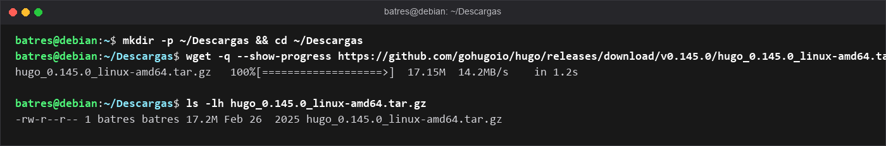

#### Paso 2: Extracción del archivo comprimido
* **Enunciado:** Descomprimir el archivo `.tar.gz` descargado con la herramienta `tar` para extraer el binario ejecutable `hugo`, el archivo `README.md` y la licencia.
* **Captura:**
  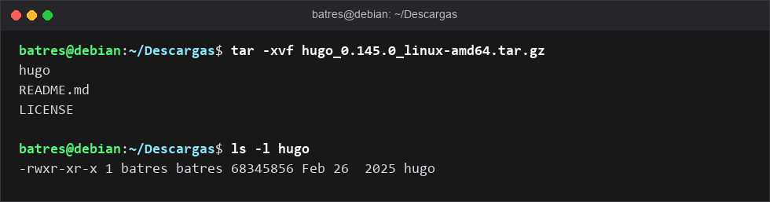

#### Paso 3: Hacer el binario accesible en el PATH
* **Enunciado:** Mover el binario `hugo` al directorio `~/.local/bin/` o `/usr/local/bin/` para poder invocarlo desde cualquier ruta de la terminal sin especificar la ruta absoluta.
* **Captura:**
  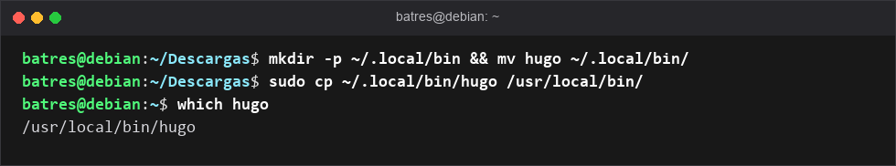

#### Paso 4: Verificación de la instalación de Hugo
* **Enunciado:** Ejecutar el comando `hugo version` para confirmar que el sistema reconoce el ejecutable de Hugo y muestra la versión correcta instalada.
* **Captura:**
  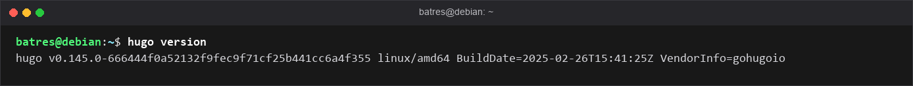

#### Paso 5: Primera comprobación rápida y creación del sitio Hugo
* **Enunciado:** Crear un nuevo sitio web con el comando `hugo new site mi-sitio`, entrar al proyecto y compilarlo con `hugo` para comprobar la generación de la estructura.
* **Captura:**
  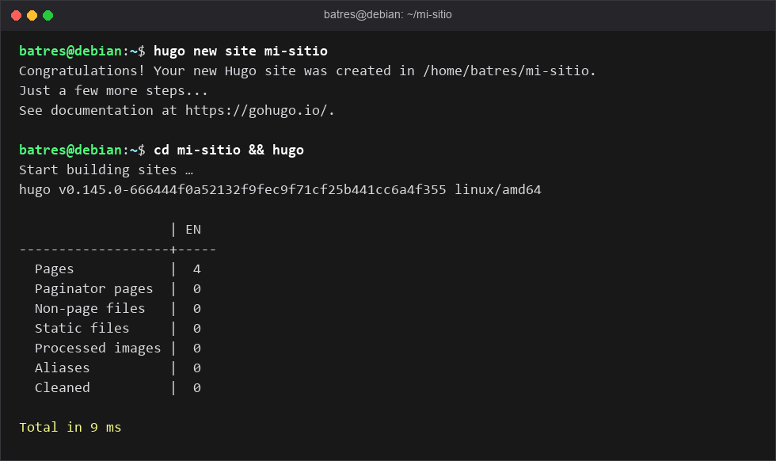

---

### PARTE 2: Publicación del Sitio Hugo con Nginx en Localhost (SRI P1.2)

#### Paso 6: Comprobación conceptual de 127.0.0.1 y localhost
* **Enunciado:** Verificar la conectividad interna con la dirección loopback `127.0.0.1` (`localhost`) mediante `ping` para comprobar que la pila de red local responde.
* **Captura:**
  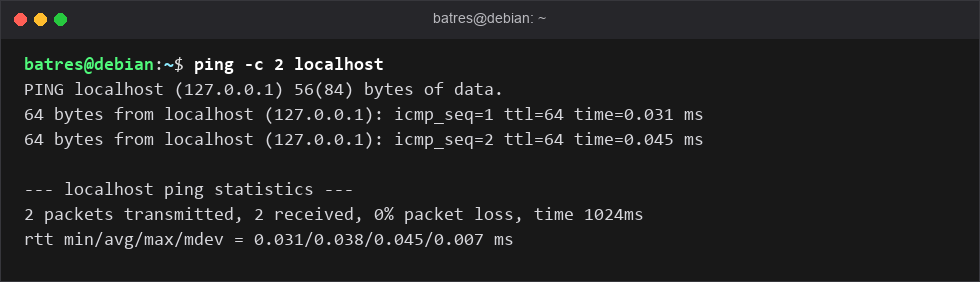

#### Paso 7: Instalación del servidor web Nginx
* **Enunciado:** Actualizar los repositorios con `sudo apt update` e instalar el servidor web Nginx mediante `sudo apt install -y nginx`.
* **Captura:**
  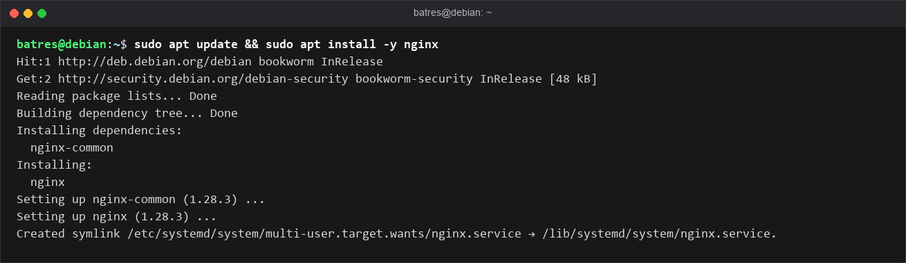

#### Paso 8: Verificación del servicio Nginx y puerto 80
* **Enunciado:** Verificar con `systemctl status nginx` que el servicio está en ejecución (`active`) y con `ss -tln | grep :80` que está escuchando en el puerto 80.
* **Captura:**
  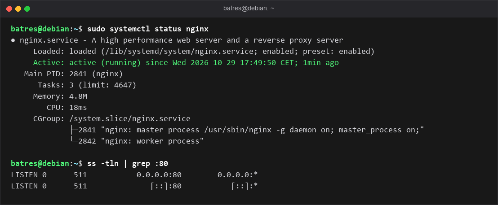

#### Paso 9: Primera prueba con curl a localhost (Página por defecto)
* **Enunciado:** Ejecutar `curl http://localhost/` para comprobar que Nginx responde correctamente con su página de bienvenida predeterminada.
* **Captura:**
  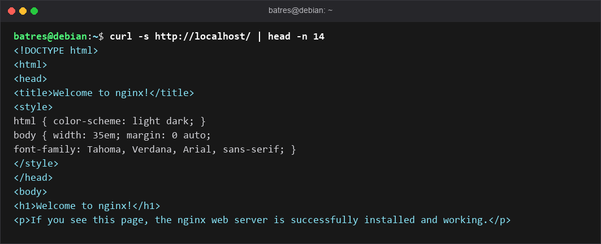

#### Paso 10: Generación de ficheros estáticos con Hugo
* **Enunciado:** Ejecutar `hugo` dentro del directorio del proyecto para compilar la web en la carpeta `public/` y listar los ficheros HTML generados.
* **Captura:**
  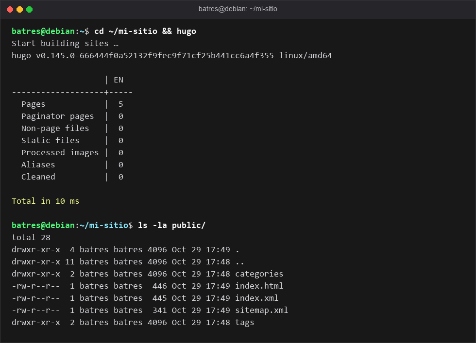

#### Paso 11: Creación del Virtual Host en Nginx
* **Enunciado:** Crear el fichero `/etc/nginx/sites-available/mi-sitio` configurando `listen 80 default_server;`, `server_name _;` y el `root` apuntando a `/home/batres/mi-sitio/public`.
* **Captura:**
  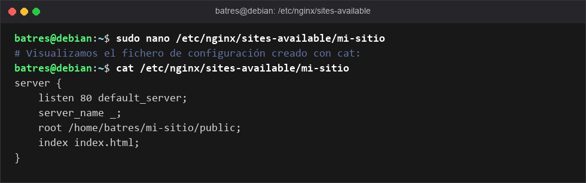

#### Paso 12: Habilitar el nuevo sitio y recargar Nginx
* **Enunciado:** Crear el enlace simbólico en `sites-enabled/`, borrar el sitio `default`, comprobar la sintaxis con `sudo nginx -t` y recargar con `sudo systemctl reload nginx`.
* **Captura:**
  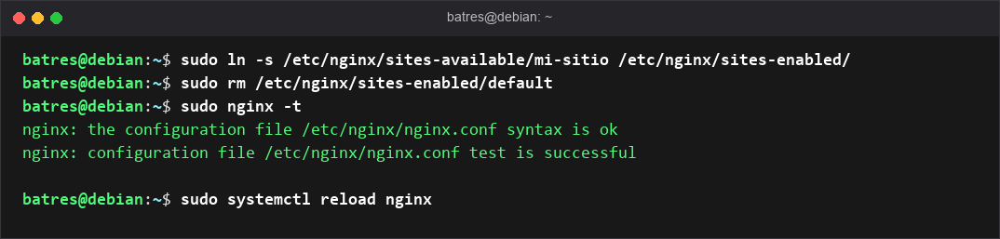

#### Paso 13: Comprobación del sitio Hugo en localhost con Nginx
* **Enunciado:** Ejecutar `curl http://localhost/` para verificar que el servidor web ahora responde con el contenido de nuestro sitio Hugo y no la bienvenida.
* **Captura:**
  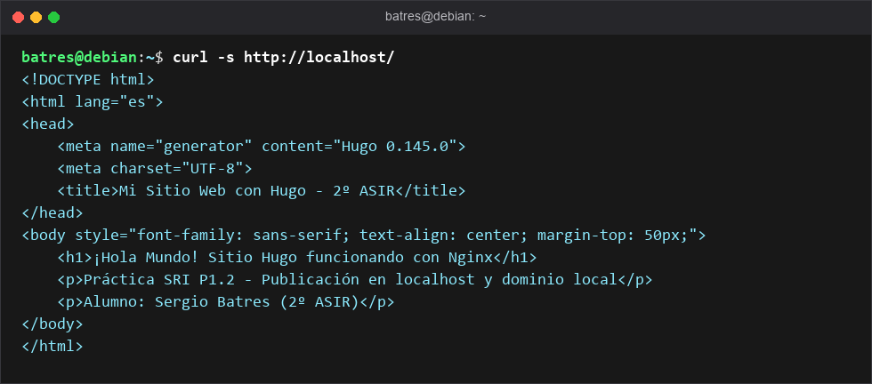

#### Paso 14: Acceso a la web por dirección IP sin DNS
* **Enunciado:** Averiguar la IP de la máquina mediante `ip a` y realizar una petición HTTP directa con `curl http://IP_VM/` para simular el acceso sin intervención de DNS.
* **Captura:**
  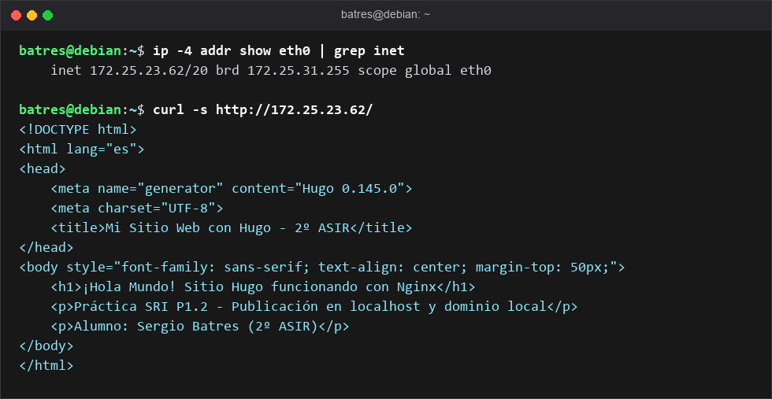

#### Paso 15: Configuración de resolución de nombres local en /etc/hosts
* **Enunciado:** Editar el fichero `/etc/hosts` para asociar la dirección IP de la VM con el nombre de dominio personalizado `batres.fp-bits.org`.
* **Captura:**
  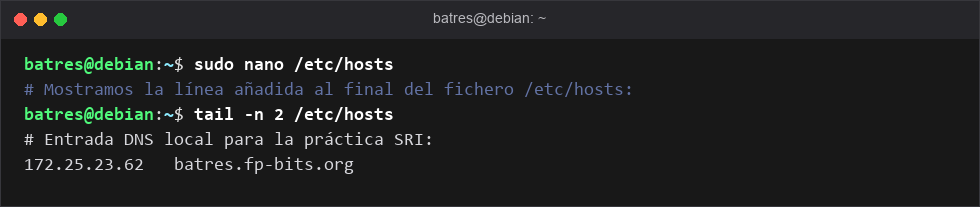

#### Paso 16: Prueba de resolución DNS y acceso web por nombre
* **Enunciado:** Ejecutar `ping -c 2 batres.fp-bits.org` para verificar que el nombre resuelve a la IP configurada y `curl http://batres.fp-bits.org/` para ver la web.
* **Captura:**
  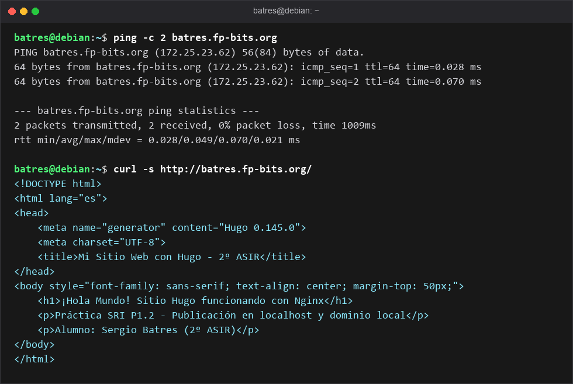

#### Paso 17: Virtual Host específico por nombre de dominio
* **Enunciado:** Modificar el fichero de Nginx con `server_name batres.fp-bits.org;` y `listen 80;` (sin `default_server`), verificar la sintaxis con `nginx -t` y recargar el servicio.
* **Captura:**
  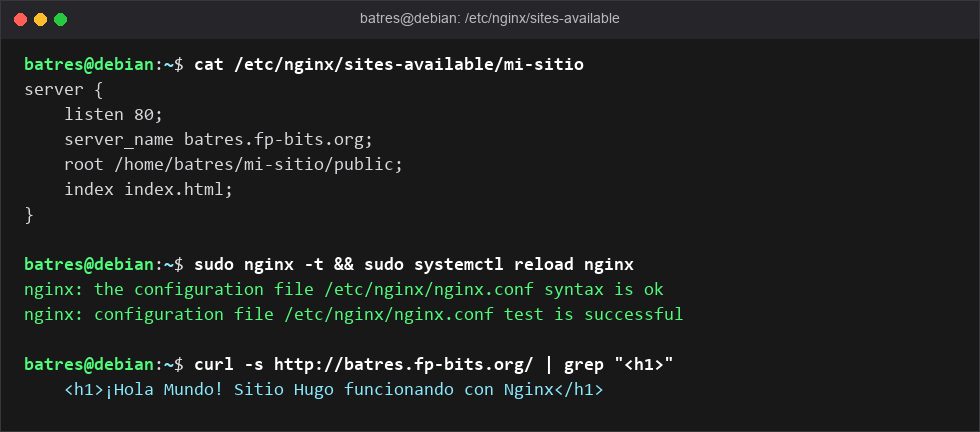

---

## 🏁 Checklist de Comprobaciones Finales

| Prueba / Comando | Resultado Esperado | Estado |
| :--- | :--- | :---: |
| `hugo version` | Binario v0.145.0 operativo en `$PATH` | ✅ Correcto |
| `curl http://localhost/` | Web Hugo servida por Nginx en puerto 80 | ✅ Correcto |
| `curl http://172.25.23.62/` | Acceso directo por dirección IP | ✅ Correcto |
| `ping batres.fp-bits.org` | Resolución local a `172.25.23.62` | ✅ Correcto |
| `curl http://batres.fp-bits.org/` | Acceso web mediante dominio virtual local | ✅ Correcto |
